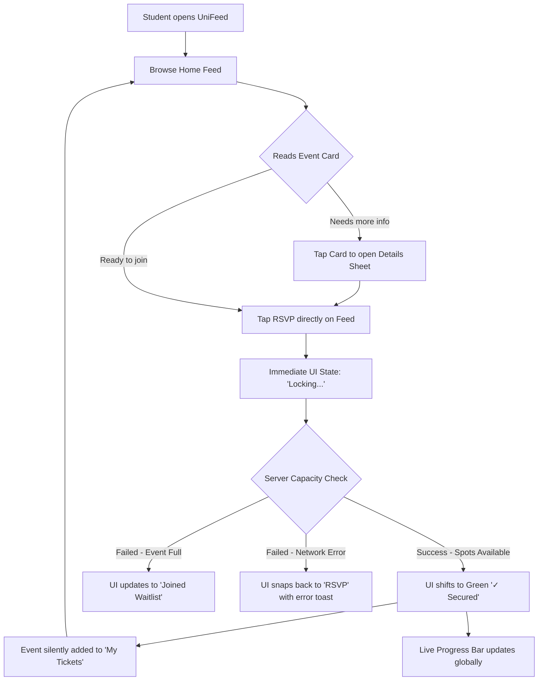
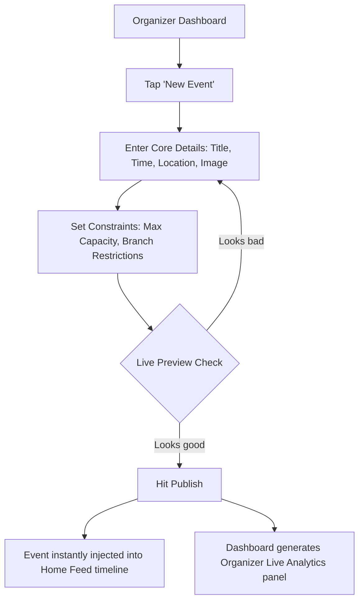
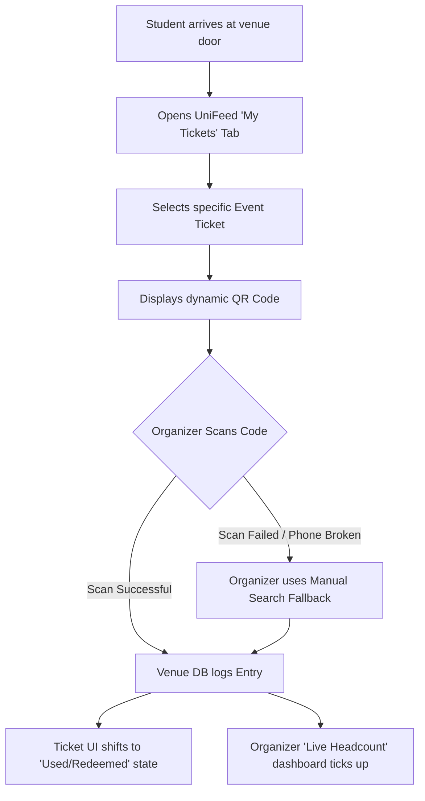

# UX Design Specification UniFeed

**Author:** Hemant
**Date:** 2026-04-03

---

<!-- UX design content will be appended sequentially through collaborative workflow steps -->

## Executive Summary

### Project Vision
UniFeed is a "Functional Social" platform designed to centralize and secure the campus experience. It modernizes the way university students discover events and engage with clubs by replacing fragmented social media silos with a premium, exclusive, real-time web application with a minimalist, high-fidelity design.

### Target Users
- **General Students:** Seeking instant access to campus events with zero friction. They value clean aesthetics, speed, and real-time live metrics without visual clutter.
- **Club Organizers:** Seeking effortless event management, live capacity tracking, and visually intuitive analytics without steep learning curves.

### Key Design Challenges
- **App-Like Web Experience:** Ensuring the mobile web interface feels as responsive and premium as a native application while maintaining a clean, balanced aesthetic.
- **Information Hierarchy:** Balancing the display of rich event data (Live capacities, times, locations, RSVPs) in the "Home Feed" without overwhelming the user.
- **Accessible Analytics:** Translating complex organizer data into digestible, actionable visualizations.

### Design Opportunities
- **Interactive Digital Passport:** Elevating the standard login flow into a visually clean, Wallet-style digital identity card.
- **Balanced Micro-Interactions:** Utilizing real-time data to power subtle, engaging animations (like Live Capacity bars) that feel premium and functional rather than overly futuristic.

## Core User Experience

### Defining Experience
The defining experience of UniFeed revolves around the "Home Feed." It must deliver a hyper-local, relevant stream of campus events that feels instantly recognizable and effortless to navigate. The primary action—discovering an event and securing a spot—must require minimal cognitive load.

### Platform Strategy
UniFeed is a mobile-first web application. While accessible on desktops (critical for Organizers parsing analytics), the student experience is explicitly optimized for touch interfaces on mobile viewports. The application must avoid standard web quirks (like delayed tap highlights or shifting layouts) and emulate a native app feel.

### Effortless Interactions
- **The "One-Tap" RSVP:** Because user identity is already anchored to their `.edu` session, registering for events or joining a club requires only a single tap. No secondary confirmation forms.
- **Invisible Authentication:** Post-registration, the digital passport keeps the user authenticated seamlessly, treating the user's presence as a verified trust token.

### Critical Success Moments
- **The Instant Sync:** The exact moment a student taps RSVP and sees the Live Capacity bar update instantly. This immediate feedback loop validates their action and creates a sense of competitive urgency (FOMO).
- **The Organizer Dashboard Access:** The moment a club volunteer logs in and instantly sees a populated heatmap of their event without needing to manually refresh or export data.

### Experience Principles
1. **Balanced Minimalism:** The UI must remain clean and structured. Function shapes the form. Event details and capacity metrics take precedence over decorative visuals.
2. **Immediate Feedback:** Every user action (like, RSVP, share) must trigger an immediate, high-fidelity state change on the UI to communicate success.
3. **Frictionless Trust:** By leveraging `.edu` emails, eliminate all unnecessary "verification" steps in standard user flows.
4. **Mobile-Native Physics:** Interactions should respect touch targets, scrolling inertia, and responsive thresholds expected of native mobile applications.

## Desired Emotional Response

### Primary Emotional Goals
- **Clarity:** Replacing the chaos of fragmented group chats with a single, highly readable source of truth.
- **Trust & Legitimacy:** Leveraging the `.edu` anchor so students feel they are in an official, safe, and exclusive campus environment.
- **Community Connection:** Fostering a genuine sense of belonging and awareness of the active campus pulse.

### Emotional Journey Mapping
1. **Onboarding:** Relief. The user immediately recognizes that the interface is modern, uncluttered, and built specifically for their demographic.
2. **Browsing the Home Feed:** Focused and informed. The lack of visual noise allows them to digest event data (Who, What, When, Where) effortlessly.
3. **Taking Action (RSVP):** Empowered and fast. The one-tap interaction feels incredibly snappy.
4. **Post-Action:** Confident. The immediate physical feedback of the UI updating establishes total certainty that their action was registered.

### Micro-Emotions
- **Confidence > Confusion:** Driven by balanced minimalism and stark data hierarchy.
- **Trust > Skepticism:** Driven by real-time sync metrics showing exactly how many people are attending.
- **Inclusion > Isolation:** Driven exclusively by seeing their peers actively engaging in the same digital space.

### Design Implications
- **To enforce Clarity:** Use generous whitespace, highly legible typography (like Inter or Roboto), and strictly limit the use of primary accent colors to actionable elements only.
- **To enforce Trust:** When real-time data changes (like a capacity bar filling up), it should animate smoothly—not aggressively—so it feels reliable, not glitchy.

### Emotional Design Principles
1. **Calm by Default:** The interface shouldn't scream for attention. It should be a calm tool the user controls.
2. **Immediate Affirmation:** Every action must instantly reward the user with subtle, positive visual feedback (a color shift, a gentle snap animation).
3. **Exclusive but Accessible:** It should feel like a premium, private club (due to the `.edu` restriction) but the actual usability must be accessible to everyone instantly.

## UX Pattern Analysis & Inspiration

### Inspiring Products Analysis
1. **Instagram (Home Feed Mechanics):** Masters of the frictionless, highly engaging, single-column scroll. Information is prioritized visually in self-contained cards.
2. **Apple Wallet (Interaction Trust):** Masters of the "One-Tap" success state. Interactions feel instantly reliable, secure, and permanent without requiring confirmation dialogs.
3. **Stripe Dashboard (Data Visualization):** Masters of displaying dense, complex analytics in a clean, high-contrast, minimalist format that is instantly legible.

### Transferable UX Patterns
- **Full-Width Event Cards (Instagram-style):** Each event in the Home Feed is a visually distinct card containing all critical info (Time, Location, Live Capacity) directly on the surface. No "read more" clicks required for core data.
- **Instantaneous State Changes (Apple Wallet-style):** The RSVP button responds immediately with a positive physical snap/color shift, bypassing loading spinners or secondary confirmation modals.
- **Widget-Based Analytics (Stripe-style):** For organizers, data is presented in large, bold typography using distinct card widgets for different metrics (Live Attendance vs. Total Capacity). 

### Anti-Patterns to Avoid
- **Multi-Step Registrations (The Eventbrite Problem):** Forcing users to confirm their name/email when we already possess their `.edu` identity.
- **The "Ghost Town" Metric:** Displaying a giant "0 / 100 Attending" if an event just launched. Instead, use encouraging copy like "Be the first to secure a spot."
- **Overstuffed Navigation Bars:** Putting everything in a bottom nav or hamburger menu. We must keep navigation strictly limited to the absolute essentials (Feed, My Tickets, Profile).

### Design Inspiration Strategy
**What to Adopt:**
- The card-based vertical scroll for the Home Feed to guarantee familiarity for Gen Z users.
- Minimalist, high-contrast charts for Organizer analytics.

**What to Adapt:**
- Social mechanics. We adapt the speed and visual appeal of social media feeds, but strip out the algorithms. Our feed is chronological or strictly relevance-based to remain functional.

**What to Avoid:**
- Any interaction that requires opening a new browser tab or modal window for basic tasks. Everything should happen in-line to maintain the native-app feel.

## Design System Foundation

### 1.1 Design System Choice
**shadcn/ui combined with Tailwind CSS.** 

### Rationale for Selection
1. **Total Visual Control:** Because shadcn/ui copies the component code directly into our repository (rather than installing it as an immutable dependency), we retain absolute control over the styling, allowing us to implement our minimalist, high-fidelity vision without fighting overriding styles.
2. **Native Accessibility:** It leverages Radix UI primitives under the hood, ensuring that complex interactive elements (like modals for filtering, or dropdowns) are fully accessible by default and function smoothly on mobile devices.
3. **T3 Stack Synergy:** It is explicitly designed to work flawlessly with Next.js App Router and Tailwind CSS, perfectly matching our finalized technical architecture.
4. **Avoids "Corporate" Aesthetics:** Unlike MUI or Ant Design, shadcn/ui does not force a specific brand identity, allowing us to maintain a clean, student-focused "functional social" vibe.

### Implementation Approach
- Initialize `shadcn-ui` into the T3 stack immediately after project creation.
- Keep the `globals.css` highly restricted. Only define core CSS variables for our primary semantic colors (Background, Foreground, Primary Action, Muted, Destructive).
- Build the "Home Feed" cards strictly using standard Tailwind utility classes, leveraging `shadcn/ui` only for complex interactive controls (Dialogs, Sheets, Selects).

### Customization Strategy
- **Typography:** Implement a modern, highly readable sans-serif font (e.g., `Inter` or `Geist`) globally.
- **Borders & Radii:** Utilize consistent, slightly generous border radii (e.g., `rounded-xl` or `rounded-2xl`) for cards to emulate native mobile iOS/Android physics.
- **Animations:** Implement `tailwindcss-animate` for subtle, highly responsive micro-interactions (e.g., the snap feedback on the RSVP button).

## The Defining Interaction

### 2.1 The "Magic Moment" (Scroll & Snap)
The core interaction that defines UniFeed is the combination of the passive "Home Feed" scroll and the active "One-Tap RSVP". If the platform can make securing a spot feel as effortless as liking a photo on Instagram, we will have solved the primary friction point of campus engagement.

### 2.2 Re-wiring the Mental Model
- **Current Model:** Fragmented discovery (WhatsApp) → High-friction confirmation (Google Forms) → Low confidence (No confirmation email).
- **Target Model:** Unified discovery (Home Feed) → Zero-friction confirmation (One-Tap) → Instant visual confidence.

### 2.3 Interaction Success Criteria
- **Zero Forms:** Once logged in (via `.edu`), the user must never type their name or email to join an event or club.
- **Sub-3 Second Action:** Users must be able to comprehend an event's details and RSVP within three seconds of it entering the viewport.
- **No Page Reloads:** The interaction must conclude entirely client-side, with state updating optimistically.

### 2.4 Novel UX Patterns
While vertical feeds are established, our novel twist is the **"Live Capacity Momentum."** 
Instead of static numbers, we use moving progress bars powered by WebSockets. Seeing a bar physically update in real-time replaces the need for "pushes" or "notifications" by creating a passive sense of urgency and community presence.

### 2.5 Experience Mechanics (The RSVP Flow)
1. **Initiation:** The user's scroll pauses on a full-width Event Card. The visual hierarchy immediately pushes the Live Capacity bar and the RSVP button into focus.
2. **Interaction:** The user taps "RSVP".
3. **Immediate Feedback:**
   - The button utilizes a micro-animation (`active:scale-95`) to simulate physical depression.
   - The button state transitions instantly (Optmistic UI update) to "✓ Secured" with a distinct color shift.
   - The Live Capacity bar smoothly animates up by one digit.
4. **Completion:** The event is silently and instantly added to the user's "My Tickets" digital passport. No modal interrupts the feed; the user can immediately continue scrolling.

## Visual Design Foundation

### 3.1 Color System
The color palette prioritizes high-contrast readability and limits accent colors specifically to drive user action.
- **Base/Surfaces:** Pure White (`bg-white`) / Pitch Black (`bg-black`) to provide maximum canvas contrast. Component cards sit on subtle gray variations (`bg-slate-50` / `bg-zinc-900`).
- **Primary Action:** A vibrant, modern Blue/Indigo (e.g., `bg-blue-600`). This color is reserved EXCLUSIVELY for the primary path (e.g., the RSVP button).
- **State Colors:** 
  - **Success:** Vibrant Green (`text-green-500`) for visual confirmation of secured spots.
  - **Muted/Metadata:** Slate/Zinc grays (`text-slate-500`) for secondary information (times, locations, total capacity) to establish visual hierarchy without clutter.

### 3.2 Typography System
- **Primary Font Family:** `Inter` (or Next.js `Geist`). Chosen for its exceptional legibility on mobile viewports and beautiful tabular numbers.
- **Hierarchy:**
  - **Headers (Events/Clubs):** `font-semibold` or `font-bold`, tight tracking (`tracking-tight`), sizing between `text-xl` to `text-2xl`.
  - **Body/Description:** `font-normal`, relaxed line height (`leading-relaxed`), `text-base`.
  - **Metadata (Time/Location):** `font-medium`, `text-sm`, `text-muted-foreground`.

### 3.3 Spacing & Layout Foundation
- **Grid & Constraints:** The platform is mobile-first. For the core feed, container width is capped at `max-w-md` or `max-w-xl`. On desktop, the layout can expand (e.g., utilizing side panels for navigation/analytics) while maintaining the constrained feed width to prevent awkward text stretching.
- **The 8-Point Grid:** Spacing strictly adheres to Tailwind's default 8-point base (`p-4`, `p-6`, `gap-4`). 
- **Card Physics:** Event iterations utilize consistent generous padding (`p-5` or `p-6`) and rounded corners (`rounded-2xl`) to separate content logically on the feed.

### 3.4 Accessibility Considerations
- **Touch Thresholds:** All interactive elements (RSVP buttons, tabs, dropdowns) must adhere to the 44x44px minimum touch target size.
- **Contrast Ratios:** Text against background colors must meet standard WCAG AA contrast ratios (especially avoiding light gray text on white backgrounds).
- **Keyboard Navigation:** Native HTML outlines must be preserved (or elegantly styled with `ring-offset`) for desktop users navigating via keyboard.

## Design Direction Decision

### Design Directions Explored
1. **Direction A (Pure Native):** A strict single-column layout across all viewports.
2. **Direction B (Dashboard Expansion):** A responsive layout that treats mobile as a single feed and expands into a 3-column dashboard on desktop.
3. **Direction C (Grid/Masonry):** A multi-column dynamic grid of event cards.

### Chosen Direction
**Direction B: The Dashboard Expansion.**

### Design Rationale
- The vast majority of standard users (students browsing the feed) will use mobile devices. For them, the interface must remain a strict, clean, single-column vertical feed to prevent cognitive overload.
- However, "Power Users" (Club Organizers, Event Admins) will utilize desktop environments to parse analytics, export data, and create events. Expanding the layout laterally into a 3-column structure (Navigation / Core Feed / Contextual Widgets) ensures desktop space isn't wasted while preserving the dimensional integrity of the center feed.

### Implementation Approach
- **Mobile (`< md`):** Bottom tab navigation. Full-width header. Full-width event cards with native margins (`px-4`).
- **Tablet/Desktop (`md` and >):** The bottom bar transitions into a left-side sticky Sidebar navigation. The Home Feed locks to a maximum width (e.g., `max-w-xl`) in the center. An optional right-side contextual panel appears for widgets and analytics metrics.

## User Journey Flows

### 4.1 The Student Discovery & RSVP Flow
**Goal:** A student finds an interesting event and secures a spot without leaving the feed.

### 4.2 The Organizer Event Creation Flow
**Goal:** An authorized club volunteer publishes a new event to the campus.

### 4.3 The Digital Passport Entry Flow
**Goal:** Fast, secure physical entry at the venue door via strictly QR scanning.

### 4.4 Flow Optimization Principles
1. **The "Locking" Buffer:** Replacing pure Optimistic UI with an immediate, sub-second "Locking" state ensures students aren't promised a spot before the database secures it, preventing door-entry chaos.
2. **Scan-Only Pipeline:** Removing "Self check-in" eliminates vectors for abuse, ensuring venue capacity metrics remain absolutely pristine. Organizer scanning acts as the sole source of truth.
3. **Graceful Degradation:** Providing a "Manual Search Fallback" at the door ensures that common technical failures (shattered screens, bad QR scans) don't halt physical line flow.

## Component Strategy

### 5.1 Design System Components
We will utilize `shadcn/ui` for our foundational atomic components to ensure maximum accessibility and speed.
- Native usage includes: `Button`, `Input`, `Form`, `Tabs`, `Sheet` (for event details pop-up), and `Toast` (for error messaging).

### 5.2 Custom Components

#### 5.2.1 The Dynamic Event Card
**Purpose:** The primary content unit of the Home Feed.
**Anatomy:** Full-width mobile layout. 16:9 or 4:3 Hero Image. Club Avatar + Name header. Large typography for Event Title. Integrated Capacity Progress Bar. Right-aligned One-Tap RSVP button.
**States:**
- *Default:* Standard layout.
- *Locking:* RSVP button transitions to infinite spinner; disables interaction to prevent double-writes.
- *Secured:* Button fills with success color, text shifts to "✓ Secured".
- *Waitlist:* Button grays out, reads "Join Waitlist".

#### 5.2.2 The Digital Passport Ticket
**Purpose:** Fast, offline-resilient venue entry mechanism.
**Anatomy:** Vertical card layout mimicking native OS wallets. Top half contains textual metadata (Event, Time, Student Name). Bottom half contains a high-contrast max-width QR code payload.
**States:**
- *Active:* High contrast, highly legible.
- *Redeemed:* Visual opacity drops to 50%, "REDEEMED" watermark overlaps QR payload to prevent double-scanning screenshots.

#### 5.2.3 Contextual Capacity Bar
**Purpose:** Drives FOMO (Fear Of Missing Out) and urgency visually without requiring users to read numbers.
**Anatomy:** A thin horizontal `Progress` indicator.
**Interaction Behavior:** Color maps to capacity percentage. Neutral/Brand color until 75%, shifts to Warning (yellow/orange) at 75%, shifts to Critical (red) at 95%.

### 5.3 Implementation Roadmap
- **Phase 1 (The Core Shell):** Implement shadcn `Tabs` for main mobile navigation and `Sheet` overlays. Establish the base layout.
- **Phase 2 (The Dynamic Feed):** Implement the `Dynamic Event Card` and the `Contextual Capacity Bar`. Wire up the Optimistic/Locking UI states.
- **Phase 3 (The Passport):** Implement the `Digital Passport Ticket` rendering and scanner logic for Organizers.

## UX Consistency Patterns

### 6.1 Button Hierarchy
We will strictly adhere to a 3-tier button hierarchy to prevent visual clutter in the feed and dashboards.
- **Primary:** Solid filled background (Brand/Black). Used *only* for the primary action on a screen (e.g., 'RSVP', 'Publish Event', 'Login'). Never place two Primary buttons next to each other.
- **Secondary:** Outline or subtle gray background. Used for secondary actions (e.g., 'Cancel', 'Edit Draft').
- **Ghost / Icon:** Transparent background that highlights on hover. Used for tertiary actions (e.g., 'Share', 'More Options (...)', closing a modal).

### 6.2 Feedback Mechanisms
Feedback must be distinct but not overly aggressive.
- **Success:** Do not use Toast notifications for primary success actions (like RSVPing). Instead, rely on *Inline Status Changes* (the button itself turns green and says "✓ Secured"). Toasts are too disruptive on mobile feeds.
- **Errors:** Use a bottom-anchored, red-bordered `Toast` for system failures (e.g., "Network Error"). Shaking animation on form fields for invalid inputs.
- **Destructive Actions:** Any action that deletes data (e.g., "Delete Event") must trigger an explicit confirmation `Dialog` with a red "Confirm" button.

### 6.3 Form & Input Patterns
Organizers will use forms heavily to create events.
- **Label Placement:** Labels are always stacked *above* the input fields. Never use placeholder text as a replacement for a label.
- **Validation:** Validate on `blur` (when the user taps away from the input). Do not shout at the user with red text while they are still typing.

### 6.4 Loading States (Perceived Latency)
We want to eliminate the feeling of waiting.
- **Skeleton Loaders:** Do not use full-screen spinning circles. When loading the Home Feed, display gray pulsating "Skeleton" cards that mimic the exact dimensions of an actual Event Card until the data streams in.
- **Micro-interactions:** Any button tap must have sub-200ms visual feedback (a subtle scale down, or a spinner appearing *inside* the button) ensuring the app feels "alive" even on a 3G campus connection.

### 6.5 Navigation & Modals
- **Destructive Closures:** If a user is halfway through filling out a "New Event" form and tries to swipe down the Sheet or close the tab, trigger an "Unsaved Changes" warning. 
- **Details Overlays:** Detailed views (like reading an event description) happen inside slide-up bottom `Sheets` on mobile, preventing navigation loss and keeping the user anchored to where they were in the main feed.

## Responsive Design & Accessibility

### 7.1 Breakpoint Strategy (Tailwind Defaults)
We will utilize Tailwind CSS's default standard breakpoints, strictly adhering to a **Mobile-First** CSS methodology.
- **Base (Mobile `0px - 767px`):** The default layout. 100% width, native app styling, bottom-tab navigation.
- **`md` (Tablet `768px - 1023px`):** The transition point. Bottom tabs move to a left sidebar. The core Home Feed constraints to `max-w-lg` and centers itself.
- **`lg`, `xl` (Desktop `1024px+`):** The Dashboard Layout. The left sidebar expands to show text labels next to icons. The right contextual panel becomes visible. The Home Feed remains locked at `max-w-lg` to preserve reading widths.

### 7.2 Accessibility Strategy (WCAG AA Compliance)
UniFeed must be accessible to all students. We are targeting baseline **WCAG AA** compliance.
- **Contrast Ratios:** All text, especially dates and event metadata, must maintain a `4.5:1` contrast ratio against its background. (No light-gray text on white backgrounds).
- **Audio Announcements:** Because the RSVP button utilizes a visually dynamic "Locking" to "Secured" state without a page reload, the button must include `aria-live="polite"` so screen readers announce "RSVP successful" to visually impaired users.
- **Keyboard Navigation:** The desktop dashboard must be fully navigable via the `Tab` key. Custom components must utilize Tailwind's `focus-visible:ring` to clearly highlight which element is currently selected.
- **Dynamic Type Safety:** Never use fixed height wrappers on text elements. Card heights must expand dynamically to respect iOS/Android system-level "Large Text" accessibility settings.
- **Motion Sensitivity:** All tactile UI animations (button scaling, slider snapping) must be wrapped in `motion-safe:` Tailwind classes, snapping instantly for users with OS-level 'Reduce Motion' enabled.

### 7.3 Testing Strategy
- **Responsive Testing:** Developers must use Chrome DevTools device mirroring to test on actual mobile viewports (e.g., iPhone SE size all the way up to iPad Pro), ensuring no horizontal scrolling occurs.
- **Accessibility Testing:** The Lighthouse Accessibility audit will be run during CI/CD. The application must consistently score a 95+.

### 7.4 Developer Guidelines
1. **Never use fixed pixels for widths:** Always use Tailwind percentage utilities (`w-full`) or viewport units (`vw`) to allow the browser to scale the app natively.
2. **Hit Targets:** Any tappable area (RSVP buttons, link tabs) must have a minimum physical size of `44x44px` to prevent "fat-finger" misclicks on mobile devices.
3. **Network Responsiveness:** "Responsive" extends to data payloads. `Next/Image` or standard responsive image arrays (`srcset`) *must* be used for Event Posters. Never serve a desktop-resolution image to a mobile device.
